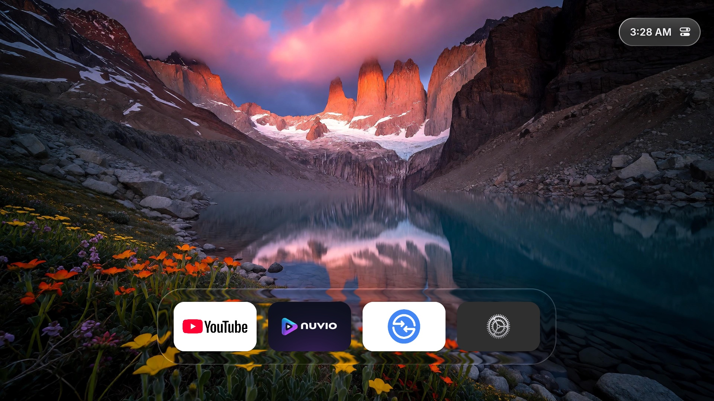
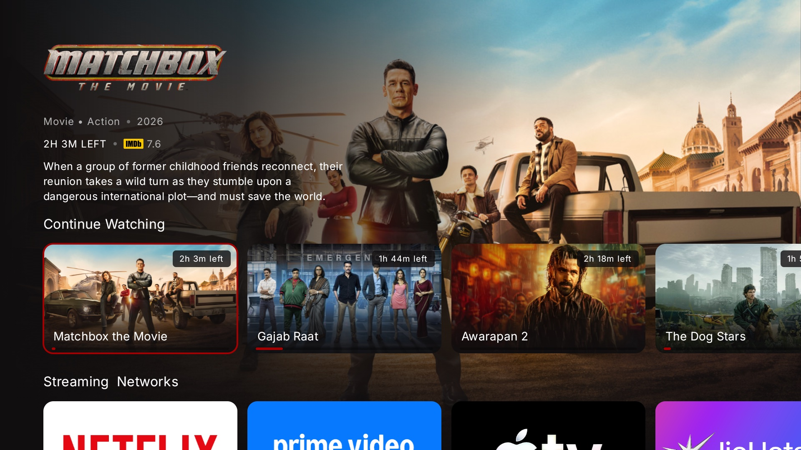
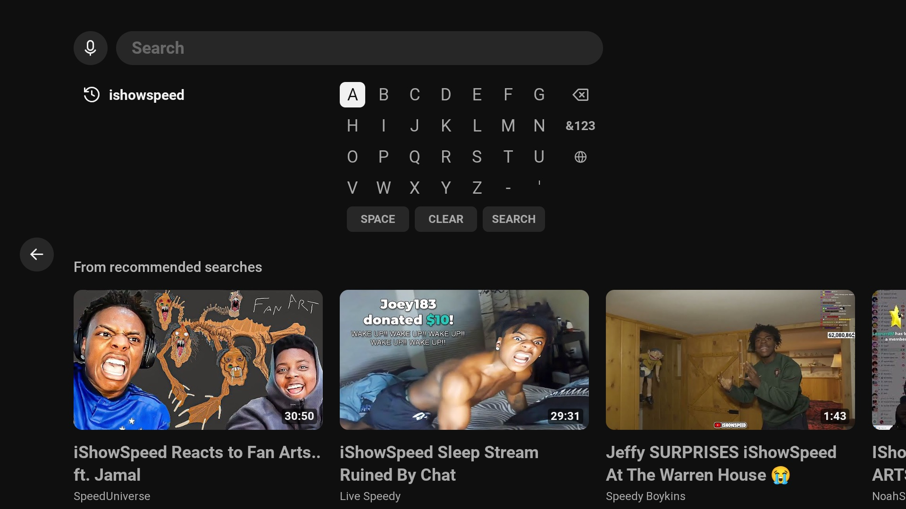

# Pixel to TV Box 📺

[](LICENSE)
[](#)
[](#)
[](#)

> Turn any broken-screen **Google Pixel** (or Android phone with USB-C DisplayPort Alt Mode) into a dedicated, high-performance, standalone **Android TV Box** with an Apple tvOS interface!

---

## 📸 Screenshots

<p align="center">
  
</p>

<p align="center">
  
  
</p>

---

## 🌟 Why This Project?

Modern flagship phones (like Google Pixel 8 with Google Tensor G3) are drastically more powerful than standard Android TV boxes, Fire Sticks, or cheap streaming dongles. When a screen shatters or the digitizer starts ghost-clicking, the phone usually ends up in e-waste.

**Pixel to TV Box** revives your device into a silent, 4K/1080p standalone media hub:
* **No Phantom Touches**: Completely unloads kernel touchscreen drivers so broken digitizers never interrupt playback.
* **Pixel-Perfect 16:9 1080p Output**: Eliminates black side pillarboxes on TV screens.
* **Auto-HDMI Mirroring**: Plug into **ANY TV or monitor** and it mirrors instantly without prompting *"Mirror or Desktop"*.
* **True Kiosk Fullscreen**: Permanently removes clock, battery, and notification icons via Binder IPC (`IStatusBarService`).
* **Apple tvOS Launcher Interface**: Supports modern TV launchers like [GlassTV](https://github.com/preetstyle/GlassTV) in classic dock mode.
* **24/7 Docking Safety**: Built-in 80% battery charging protection and zeroed internal screen brightness keeps the device cool at 26°C.
* **Always-On Wireless ADB**: Connect over Wi-Fi on port 5555 anytime without physical USB cables.

---

## 🛠️ Hardware Requirements

1. **Google Pixel 8 / 8 Pro / 8a / 9** (or any Android phone supporting DisplayPort Alt Mode over USB-C).
2. **Root Access**: Magisk v26+, KernelSU, or APatch.
3. **USB-C Hub / Dongle**: With HDMI port + USB-C Power Delivery (PD pass-through) to power the phone 24/7.
4. **Any TV or Monitor**: 1080p or 4K with an HDMI input.
5. **Remote Control**:
   - Google TV App (virtual D-Pad remote on iPhone/Android).
   - Any Bluetooth remote (Google TV remote, Fire TV remote, Air Mouse, or gamepad).

---

## 🚀 Quick Start (Installation)

### Method 1: Magisk / KernelSU Module (Recommended)
1. Download `pixel-tv-box-magisk.zip` from the latest release.
2. Open **Magisk app** (or KernelSU Manager) on your phone.
3. Go to **Modules** -> **Install from storage** -> Select `pixel-tv-box-magisk.zip`.
4. Reboot the phone and plug in your HDMI hub to the TV!

### Method 2: 1-Click ADB Installer
With your phone connected via USB or Wireless ADB:
```bash
git clone https://github.com/preetstyle/pixel-tv-box.git
cd pixel-tv-box
./setup.sh
```
The script will automatically push boot scripts, install the kiosk daemon, set resolution, and start the TV Box service.

---

## 📱 Recommended TV Apps & Setup

For the cleanest standalone television experience:

| App | Description |
| :--- | :--- |
| **[GlassTV](https://github.com/preetstyle/GlassTV)** | Custom Apple tvOS-style launcher with interactive classic dock |
| **[TizenTube](https://github.com/reisxd/TizenTube)** / **SmartTube** | Ad-free, high-performance YouTube client tailored for TV remotes |
| **[Nuvio TV](https://nuvio.app)** | Media streaming app with D-Pad TV navigation |
| **[Send Files to TV (SFTV)](https://play.google.com/store/apps/details?id=com.yablio.sendfilestotv)** | Effortless local file transfer from your PC/phone to the TV box |
| **LeanKeyboard** | Lightweight Android TV on-screen keyboard navigable via remote control |

---

## 🎮 Navigation & Remote Control

You don't need a physical keyboard or mouse connected to your TV:
1. **Google TV App**: Open the Google TV / Home app on your primary smartphone. Tap **TV Remote** to connect via Wi-Fi for D-Pad, Home, Back, and Volume buttons.
2. **Bluetooth Remote**: Pair an official Google Chromecast / Fire TV remote via Bluetooth Settings.
3. **LeanKeyboard IME**: Included configuration switches Android's virtual keyboard to a TV-friendly grid keyboard controlled with arrow keys.

---

## 🏗️ Architecture & How It Works

For an in-depth breakdown of how we solved phantom touches, Android 15/17 external display negotiation, and system kiosk suppression, read the **[Technical Architecture Guide](docs/ARCHITECTURE.md)**.

---

## 🔄 Uninstallation (Restore Phone)

If you ever want to revert your device back to standard smartphone mode:
```bash
./uninstall.sh
```
Or simply disable/remove the module from Magisk and reboot.

---

## 📄 License

This project is licensed under the [MIT License](LICENSE).
Contributions, PRs, and suggestions are welcome!
